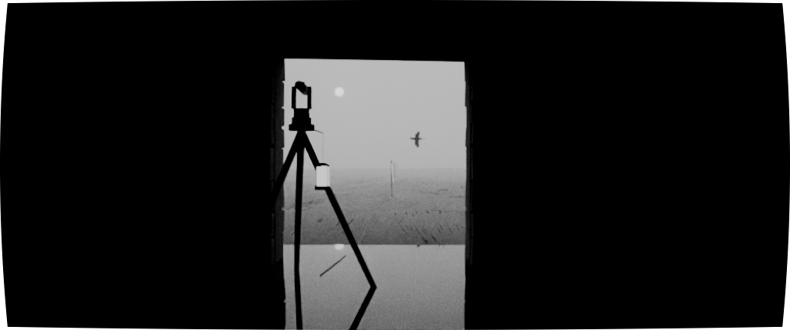
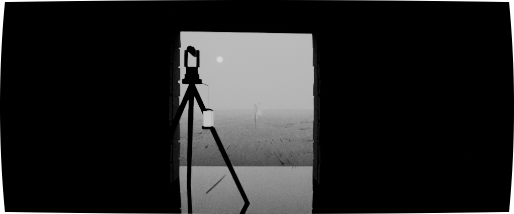
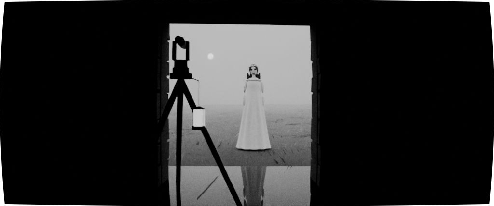

# THE SURVEY: "Station Zero"

A single 15-second shot for *The Survey*, built entirely by a Blender Python script.
The look follows the reference stills and clips: pale faces with blackened eyes against
pure black, a white bride, a dark stone doorway framing a field whited out by fog, a
hazed moon, crows crossing a bright opening, and a flooded floor that mirrors it all.

## The shot

We're inside a dry-stone shelter, low down, looking out through its doorway. The walls
are solid black and frame a bright white field of fog, with a low moon hazed in it. The
shelter floor is flooded, so the doorway shines again in the black water.

Just inside the threshold, a surveyor's theodolite stands silhouetted, with a lantern
hanging from its tripod. A chain tape runs from it through the water and out to the first
stake. The line of flagged stakes leads straight away into the white.

Crows cross the opening. Far out on the line, barely there, stands a woman in white.

Each time the lantern gutters out, she is one stake closer. She never moves while the
light is on. The last time it relights she is standing on the threshold: white slip
dress, veil, a crown of small white flowers, long black hair, a chalk face with blackened
eyes and lips. Her reflection stands under her in the water. Focus racks slowly from the
instrument to her.

| Frames | Beat |
|---|---|
| 1–95 | Establish: the doorway, the instrument, the line. Crows cross (~20–110). She is at 138 m, lost in the fog |
| 96 · 168 · 232 · 292 | Blackouts (4 frames each). She moves to 78 → 44 → 23 → 11 m |
| 330 | Last blackout. She is on the threshold (2 m outside the door) |
| 340–356 | Focus racks from the theodolite to her face. Hold to 360 |

The blackouts are marked on the timeline as `Dark 1` to `Dark 5`. They are the natural
points for cuts and sound.

## The look

Every source of light is either the fog outside or the lantern inside, so the walls fall
to true black and the doorway is the only shape in the frame, like the stone-window
reference. A stone core inside the walls keeps the chinks from leaking light. A slit in
the right-hand wall is the only other opening.

The compositor turns the image black and white and adds halation, so the doorway and the
lantern bloom into the dark. It also applies a hard tone curve (crushed blacks, highlights
pushed to paper white), a heavy vignette that falls to black, fine grain that changes
every frame, and a touch of lens barrel. The frame is 2.39:1 at 2048 × 858.

## Running it

Requirements: **Blender 5.0 or later**. On 4.2–4.5 the scene still builds, but renders
in colour, because the compositor API changed in 5.0.

- **In Blender**: open the *Scripting* workspace, open `the_survey_station_zero.py`, and
  click **Run Script**. It replaces everything in the current file.
- **Build and save a .blend from a terminal**:
  `blender --background --python the_survey_station_zero.py`
- **Render a test frame**:
  `blender -b --python the_survey_station_zero.py -- --still 345 --samples 64 --percent 50`
- **Render the shot** to `render/` as a PNG sequence:
  `blender -b --python the_survey_station_zero.py -- --animation`

Other flags: `--grass N` sets the number of grass parents, `--no-grade` renders the raw colour
pass, `--no-save` skips writing the .blend, and `--out path.png` sets the still's filename.

The preview frames here were rendered at 50% size with 48 samples and reduced grass, so
they are noisier than a full render. Use Cycles (the fog needs it), on a GPU if possible.

## Tuning

All the dials are at the top of the script in the `TUNING` block:

- `FIGURE_STEPS`: when she moves and where to. Blackouts follow from it automatically.
- `FOG_DENSITY`, `GROUND_FOG`, `SKY_STRENGTH`, `MOON_GLOW`, `LANTERN_WATTS`: how white
  the doorway burns and how far you can see.
- `CROWS`: the size of the flock.
- `BW_WEIGHTS`, `GRAIN`, `VIGNETTE`, `GLOW`, `EXPOSURE`: the film look.
- `DOOR_W`, `DOOR_H`, `HUT_*`: the shelter and its doorway.
- `GRASS_PARENTS`, `GRASS_CHILDREN`: grass density, which affects render time.
- `SEED`: re-rolls the stones, stakes, flight paths and lantern flicker.

## Next passes

- **She is a blockout.** The silhouette, dress, veil, crown, hair and the dark eye and lip
  smudges read at this distance, but she needs a sculpt, or a scan of the actor in the
  references, for anything closer. Parent the replacement to the empty `Her` and it
  inherits all the animation.
- A close-up to cut to on the last relight, in the style of the face references: a
  single key, black void, and her head tilting back as in the open-mouthed still. It
  would be a short second script.
- The flooded-hall reference (the bride rising from water) suggests a later scene. The
  floodwater material here can be reused for it.
- There is no sound yet; the blackouts are the hooks.
